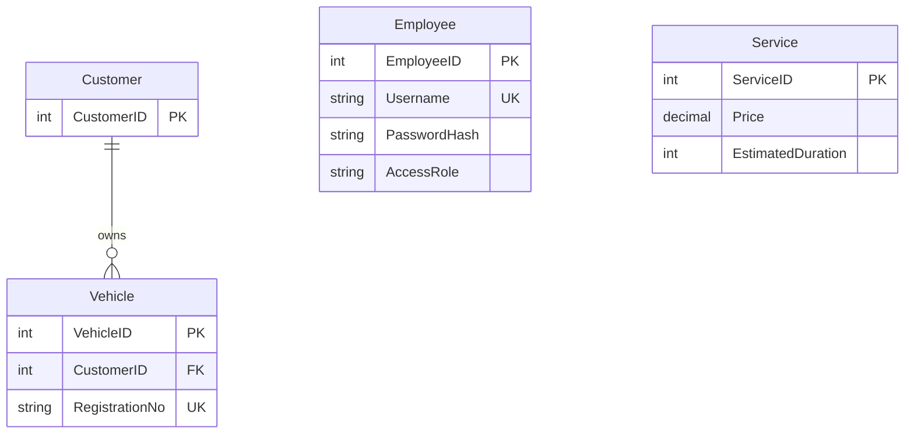
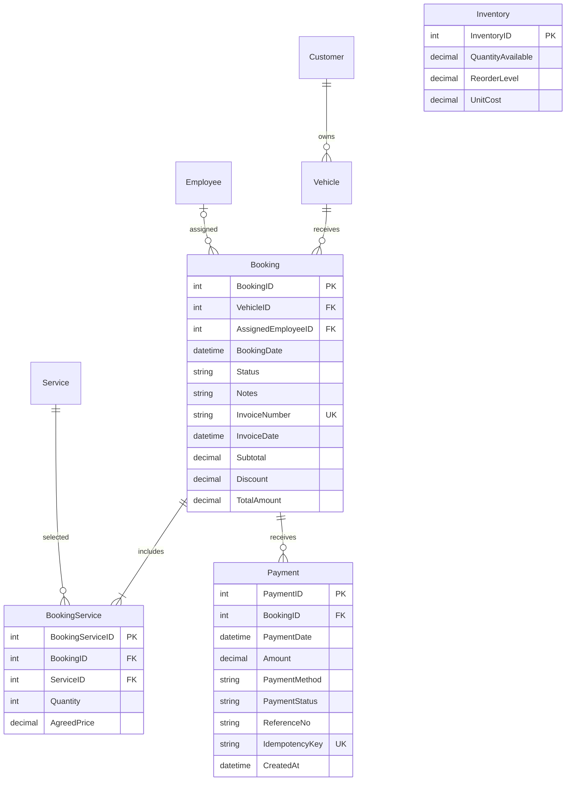

# Database design and access control

## Schema correction

The supplied proposal references BookingID but omits a Booking table, stores booking date/status on BookingService, defines a separate Invoice, and inconsistently claims eight/ten tables. The implementation requirements take precedence. Booking will hold booking header and optional invoice header fields. BookingService holds service lines only. Payment references Booking directly. No Invoice or User table is introduced. Employee optionally holds login credentials. Ownership follows Booking → Vehicle → Customer; Booking never duplicates CustomerID.

Current schema has exactly **four** application tables. No library adds session or migration tables. InnoDB, utf8mb4, restrictive foreign keys, unique normalized vehicle registration, DECIMAL money, positive duration and credential consistency CHECK constraints are used. Names and phone are validated by the API; phone is text. Timestamps are stored/read in UTC and rendered in Asia/Karachi. Authentication lasts eight hours and protected requests reload Employee activity and role. Password hashes are deliberately omitted by explicit SELECT projection.

## Planned final schema — NOT migrated at 50%

Final master fields are already present in migration 001. Planned Booking and Inventory also get CreatedAt and UpdatedAt; Inventory gets ItemName, Unit and IsActive. BookingService will enforce UNIQUE(BookingID,ServiceID), Quantity > 0 and AgreedPrice >= 0. Booking invoice fields are nullable until issuance. Payment amount must be > 0. Inventory uses DECIMAL(11,3) quantities and nonnegative money and stock. All relationships use restrictive deletion. Later milestones must implement transactions, locking and constraints in MySQL rather than trusting demo browser logic.

## Permission matrix

| Area                                        | Administrator  | Receptionist   | Service Staff            | Cashier | Manager |
| ------------------------------------------- | -------------- | -------------- | ------------------------ | ------- | ------- |
| Customers / vehicles real API               | CRUD + archive | CRUD + archive | denied                   | denied  | denied  |
| Service real API                            | CRUD + archive | read           | denied                   | denied  | read    |
| Employee real API incl salary / credentials | CRUD + archive | denied         | denied                   | denied  | denied  |
| Booking demo; real at 75%                   | manage         | manage         | own assigned jobs/status | denied  | denied  |
| Invoice / payment demo                      | manage         | denied         | denied                   | manage  | denied  |
| Inventory / reports demo                    | manage         | denied         | denied                   | denied  | manage  |
| Dashboard demo                              | view           | view           | denied                   | view    | view    |

Employee password hashes are never returned, including to administrators. Salary and credential management are administrator-only. Service Staff demo identity is employee #1; they can view only its jobs. Demo role switching is clearly labeled and is not authentication. Real server routes enforce roles independently of UI visibility. Current staff/cashier accounts can authenticate but have no future-module APIs. Administrators cannot edit/archive their own account through these endpoints; use another administrator.

## Historical and monetary rules

Master records are archived, never hard deleted. Active child vehicles block customer archive. Registration remains globally unique even after archive. Demo service lines snapshot agreed prices, aggregate repeated selections, use integer paisa calculations, freeze after invoice issuance, and permit only Pending → In Progress/Cancelled and In Progress → Completed/Cancelled. At least one employee must be assigned to start work. Invoices have one issuance per completed booking, fixed discount and no tax. Paid records are immutable, only Paid reduces balance, and idempotency keys suppress retries in the demo adapter. Browser localStorage is for a single-user demonstration, not concurrent accounting. Database-authoritative guarantees arrive only at the specified later milestones.

Reports aggregate lines and payments independently to avoid multiplicative joins. Invoiced revenue and paid collections remain distinct. Date labels identify BookingDate, InvoiceDate, PaymentDate or current-stock snapshot; daily filtering uses Asia/Karachi (UTC+05:00).
